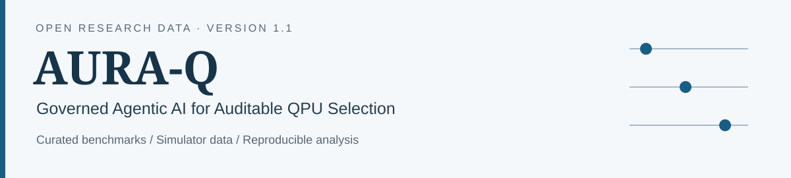

<p align="center">
  
</p>

<p align="center">
  <a href="https://github.com/sourodeepkundu2025-hub/aura-q-data/actions/workflows/validate.yml"></a>
  
  <a href="LICENSE"></a>
  <a href="LICENSES/DATA_LICENSE.md"></a>
</p>

**AURA-Q studies how natural-language preferences can guide the selection of a quantum processing unit while deterministic code retains authority over constraints and backend ranking.** This repository makes the curated benchmarks, retained simulator analyses and their provenance available for inspection and reuse.

**37 CSV files · 30 replay exports · 30- and 50-request benchmarks · zero mandatory runtime dependencies**

[Get started](docs/getting_started.md) · [Research scope](docs/research_scope.md) · [Data guide](docs/data_guide.md) · [Reproducibility](docs/reproducibility.md) · [Citation](docs/citation.md)

## Start in three commands

The current reviewed release is on `codex/aura-q-data-v1`. Use Python 3.10 or newer.

```bash
git clone --branch codex/aura-q-data-v1 https://github.com/sourodeepkundu2025-hub/aura-q-data.git
cd aura-q-data
python scripts/auraq.py validate --table-checks
```

The validator checks the 37 source files and reconstructs **29 exploratory table point estimates** from retained decision records. See [what each check establishes](docs/reproducibility.md).

```bash
python scripts/auraq.py inspect
python scripts/auraq.py summarize --file gold_decision_records.csv --output reports/gold_summary.csv
python -m unittest discover -s tests -v
```

For an installed command, run `python -m pip install -e .` and use `auraq-data`. The original `python verify_dataset.py` entry point is retained.

## Research and result previews

The research separates two responsibilities: a local language model proposes a typed preference profile; deterministic controls check constraints and rank feasible backends. The intent and routing components were evaluated independently. The replay uses historical IBM noise models with generated queue and cost contexts.

| Intent method | Reported profile macro-F1 |
| --- | ---: |
| Keyword baseline | 0.605 |
| Guarded Qwen | 0.980 |
| Guarded Mistral | 0.940 |

These are archived scores on **50 author-curated requests**, taken from [the released comparison table](data/figure_tables/intent_model_comparison.csv). The data utilities do not rerun the language models.


The sensitivity curve holds the quality weight at 0.2 and allocates the remaining weight between time and normalized cost. Negative differences favor AURA-Q under the recorded objective. [Plot sources and regeneration](docs/results.md).

## Repository map

```text
aura-q-data/
├── data/
│   ├── benchmarks/          # Authored requests and expected constraints
│   ├── exploratory_replays/ # Retained policy decisions, sweeps and grids
│   └── figure_tables/       # Five archived figure-data tables
├── src/auraq_data/          # Catalogue, validation, summaries and CLI
├── scripts/                # Source-checkout commands and plot generation
├── examples/               # Small runnable analysis examples
├── tests/                  # Integrity, arithmetic and error-path tests
├── docs/                   # Research scope, units, comparison and usage guides
├── assets/                 # Repository header and reproducible SVG previews
├── LICENSES/               # Data licence and scope
└── .github/                # Validation workflow and contribution templates
```

The [manifest](DATA_MANIFEST.json) records exact source hashes and schemas. Routing costs are normalized units; historical `cost_usd` column names are explained in the [data dictionary](DATA_DICTIONARY.md). The RUN-017 forest summary and the records outside this deposit are identified in the [research scope](docs/research_scope.md). Different model variants can use different preference objectives, so their exploratory regret scores alone do not establish agentic superiority.

## Cite, reuse and contribute

Authors: **Sourodeep Kundu and Kalyanaraman P**, School of Computer Science and Engineering, Vellore Institute of Technology, Vellore, India.

Use [CITATION.cff](CITATION.cff) or [CITATION.bib](CITATION.bib), and record the exact commit used in an analysis. The preserved first data snapshot is [106aae2](https://github.com/sourodeepkundu2025-hub/aura-q-data/tree/106aae2bf7c1bdfba0d577cccc890fac59e5e931). No dataset DOI has been assigned.

New utility software is [MIT licensed](LICENSE). Author-created data and derived previews use [CC BY 4.0](LICENSES/DATA_LICENSE.md). Contributions are welcome: read [CONTRIBUTING.md](CONTRIBUTING.md), [community conduct](CODE_OF_CONDUCT.md) and [the security policy](SECURITY.md), then open a focused issue.
