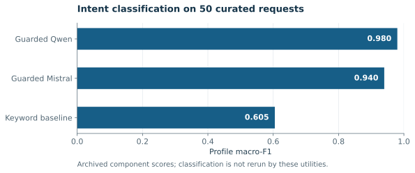
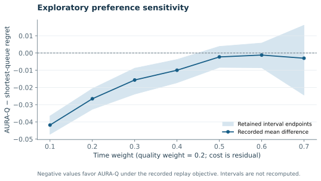

# Result previews

The README previews are generated from retained CSV tables with `scripts/generate_previews.py`. The resulting `assets/results/PLOT_PROVENANCE.json` records input and SVG hashes.

## Intent component



Source: [intent_model_comparison.csv](../data/figure_tables/intent_model_comparison.csv). The figure displays the reported profile macro-F1 scores for the keyword baseline, guarded Qwen and guarded Mistral. It begins at zero and invents no confidence intervals. The raw model predictions required to recompute those classification scores are outside the deposit.

## Preference sensitivity



Source: [one_parameter_sensitivity.csv](../data/figure_tables/one_parameter_sensitivity.csv). Quality weight remains 0.2. Time weight increases from 0.1 to 0.7, with the residual assigned to normalized cost. The line is AURA-Q minus shortest-queue regret; shading displays the stored interval endpoints. Plot generation does not rerun the bootstrap. The curve describes this replay distribution and its recorded objective.

## Regenerate

```bash
python -m pip install -e ".[plots]"
python scripts/generate_previews.py
```

This optional step exports standalone SVGs. Core dataset validation remains usable without Matplotlib.
